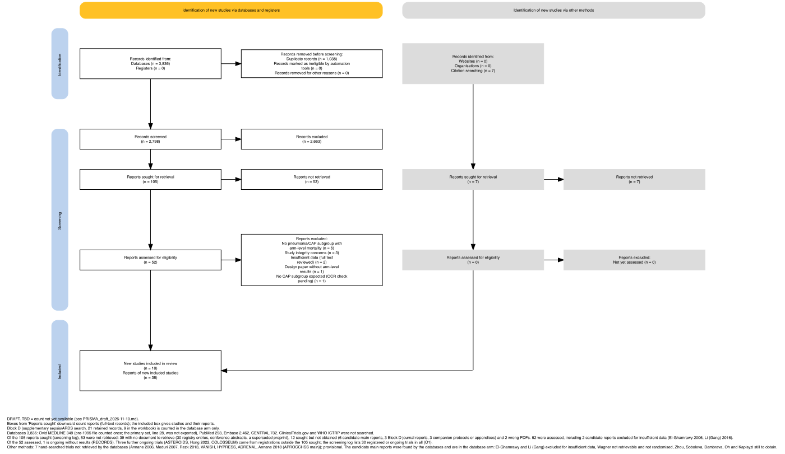

# PRISMA 2020 flow diagram — DRAFT with placeholders

**Review:** Bayesian meta-analysis of adjunctive corticosteroids in severe CAP
**Drafted:** 10 November 2026 (revised the same day: report-level counts, Block D placement, footnote)
**Status:** DRAFT. Counts that can be derived from the repository are filled; every count that is
not yet settled is shown as `TBD` and listed in the [placeholder register](#placeholder-register)
with its blocker. Do not submit this figure until the placeholders are resolved.

Sources: `Status.md` §1 (search 20 Oct: 3,931 identified / 2,798 after de-duplication), the
`records` sheet of `cap_steroids_extraction.xlsx` (one row per full-text record, 55 rows) and
`trials.csv` (`final_set`). The screening log (`screening_log_all_records.csv`) and `prisma_counts.json` are in
`~/Desktop/CAP-steroids-resources/CAP_Search_Strategy/Screening_2026-10-20/` (not copied into this repository). The
title/abstract counts below come from them (checked 10 Nov); see
[Title/abstract screening and the full-text workbook](#titleabstract-screening-and-the-full-text-workbook).

---

## Diagram

Generated with the **`PRISMA2020`** R package (Haddaway et al.) by
[analysis/prisma_flow.R](analysis/prisma_flow.R), target `prisma_flow` in the `targets` pipeline. The
target depends on the script, the extraction workbook and `trials.csv`, so a change to any of them
regenerates the figure. Regenerate with `targets::tar_make(prisma_flow)` from `analysis/`. Output:
`analysis/output/figures/prisma_flow_draft.{png,pdf}`. PNG/PDF export needs pandoc; outside RStudio set
`RSTUDIO_PANDOC` (Positron bundles it under `resources/app/quarto/bin/tools/x86_64`).

### Counting rules used

- **Records vs reports.** Identification and screening boxes count records. Every box from "Reports
  sought for retrieval" downward counts **reports** (full-text records), computed from the `records`
  sheet; the included box gives both studies (18) and their reports (38).
- **Block D in the database arm only.** The supplementary sepsis/ARDS search (protocol v2, decision A)
  was run with the database searches. The screening log retained 21 Block D records (screen code I3), 9 of which
  are in the extraction workbook; they sit inside the database counts and are not counted again under "other
  methods".
- **Smit IPD synthesis** (2023 conference abstract R2299, 2025 full report R2626) is counted among the
  reports of included studies: it reports per-trial data for 8 included trials and supplies the rank-2
  rows used in S-IPD.
- **Neither included nor excluded (footnote on the figure).** 4 ongoing trials without results (RECORDS,
  ASTEROIDS, Hong 2022, COLOSSEUM; 4 reports). Wafy 2021 was excluded on integrity grounds on 10 Nov (lead
  decision), so nothing is awaiting classification. Assessed 53 = included 38 + excluded 11 + ongoing 4; the
  script checks this.
- **Other methods arm (figure, updated 10 Nov: 7 sought, 7 not retrieved, 0 assessed; provisional).** The screening log shows that
  the 8 full texts still to obtain (El-Ghamrawy 2006, Li (Gang) 2016, Zhou 2015, Wagner 1956, Soboleva 2000,
  Dambrava 2006, Oh 2009, Kapisyzi 2012) were found by the database searches (R0437, R1251, R1098, R0001, R0235,
  R0424, R0685, R0879; codes I1 and I4). They belong in the database arm as reports sought and not retrieved. What the log
  records as identified through other methods is 7 hand-searched trials not retrieved by the databases (the Pitre
  2025 sepsis/ARDS list; see the register).

### Title/abstract screening and the full-text workbook

From `prisma_counts.json` and `screening_log_all_records.csv` (single AI-assisted pass, 20 Oct; the second screener is
pending). The log's 2,798 unique records match the 2,798 on the figure, and every one traces to one of the 12 export files.

| Box | Count | Source |
|---|---|---|
| Records screened | 2,798 | log |
| **Records excluded at title/abstract** | **2,663** | log (decision `exclude`); = 2,798 − 135. The earlier estimate of 2,743 (= 2,798 − 55) is superseded |
| Records retained | 135 | log (`include`) |
| — reports to retrieve for full text | 105 | I1 22 + I2 54 + I3 21 + I4 8 |
| — registered or ongoing trials without results (O1) | 30 | log; "report as ongoing / awaiting classification" |
| Identified through other methods, not retrieved by the databases | 7 | `prisma_counts.json` (hand-search of the inclusion lists) |

Exclusion reasons are logged by code in `prisma_counts.json` (for example no pneumonia population 708, not a primary
study 678, COVID-19 primary 414, other population 348, paediatric 166, non-randomised 97, no systemic corticosteroid 94).

**The 105 reports sought do not match the 55 rows of the workbook.** 52 of the 105 are in the `records` sheet (plus 3 of the
30 O1 registrations, which makes the 55). The other 53 are not, so the figure's "Reports sought" box (55) is too low if it is meant to
count reports sought from the screening:

| Sought, not in the workbook | n | What they are |
|---|---|---|
| Candidate main reports (I1 2, I4 6) | 8 | the 8 "other methods" texts above; not obtained |
| Block D candidates (I3) | 12 | 3 journal reports (Klastersky 1971, Cicarelli 2006, Meersseman 2025) and 9 untitled or anonymous entries that look like registry records (R0610, R0843, R0844, R0880, R1086, R1669, R2537, R2669, R2701; judged from the titles, not opened); no decision recorded |
| Companion reports (I2) | 33 | protocols, registry entries and conference abstracts of included trials (a rough title-based count: about 14 registry or protocol, 7 abstract, 12 other); no decision recorded |

#### Classification of the 53 (10 Nov; option B chosen by the lead)

One row per report in [PRISMA_unclassified_reports_2026-11-10.csv](PRISMA_unclassified_reports_2026-11-10.csv). There is no record of retrieval
attempts: the full-text folder holds exactly the 55 PDFs of the workbook (plus one unrelated antifungal paper), and the seed folder
holds no PDF of any of the 53. So **none is "obtained but not entered"**; the choice is between "not sought" and "sought and not retrieved".

| Proposed status | n | Reports |
|---|---|---|
| Sought and not retrieved | 14 | 8 candidate main reports (El-Ghamrawy, Li (Gang), Zhou: high priority to obtain; Wagner: medium; Soboleva, Dambrava, Oh, Kapisyzi: conference abstracts, low); 3 Block D journal reports (Klastersky 1971, Cicarelli 2006, Meersseman 2025; exclusion expected, low); 3 companion protocols or appendices (STOPPE protocol R1497, REMAP-CAP corticosteroid-domain appendix R1583, SONIA protocol article R2012; useful for RoB 2 domain 5) |
| Not sought | 39 | 30 registry entries (21 companions of trials in the review, 9 Block D registrations) with no document to retrieve; 8 companion conference abstracts of trials whose main report is in the workbook; the 2023 Smit preprint (superseded by the 2025 report in the workbook) |
| Obtained but not entered | 0 | none |

With these 14 plus the 2 wrong PDFs (Fitzgerald main report, Michels), the database-arm boxes can be filled in two ways; both give 50 assessed, matching the workbook:

| | Sought | Not retrieved | Assessed |
|---|---|---|---|
| **B (chosen 10 Nov): keep the log's 105 as sought** | 105 | 55 (39 not sought + 14 + 2); **53 after the 10 Nov evening update below** (39 + 12 + 2) | 50; **52 after the update** |
| A: count only reports a document was expected for | 66 (105 − 39) | 16 (14 + 2) | 50 |

Option B was chosen because it keeps the figure consistent with the screening log ("105 reports to retrieve") and does not relabel records after the fact; the
figure footnote would name the 39 that had no document to retrieve. The status of each of the 53 is inferred from the record type and the file inventory, not
from a log of retrieval attempts; the lead accepted it on 10 Nov, with the 39 "not sought" named in the figure footnote.

#### Update, evening of 10 Nov: three candidate reports resolved

Reported by R. Lewis. **Wagner 1956:** not retrievable and not a randomised study (a historical controlled trial); it stays "sought and not retrieved" because no full text was assessed. **El-Ghamrawy 2006 and Li (Gang) 2016:** obtained and reviewed (Li by Annamaria) and excluded at full text for **insufficient data**; neither was extracted into the database. Effect: sought and not retrieved 14 to 12, not retrieved 55 to 53, assessed 50 to 52, excluded at full text 11 reports of 10 studies to **13 reports of 12 studies** (new reason "Insufficient data (full text reviewed)": 2 reports, 2 studies). Recorded in `PRISMA_unclassified_reports_2026-11-10.csv` (new status "obtained and assessed"); `analysis/prisma_flow.R`, the figure and the Methods-page table follow it. *Later the same evening:* both reports were added to the extraction database (`records`, `record_roles`, `trials` with `final_set` excluded; the `records` table now has 57 rows) and the PRISMA script reads them from the workbook (it expects 57 records); the counts are unchanged. The full texts themselves are still to be saved in the full-text folder.

### Reconciliation of the full-text count (55)

`Status.md` §1 gave the 55 full-text records as 21 primary + 22 companions + 9 Block D + 2 verify +
3 other, which sums to 57. The `records` sheet has screen codes I1 = 20, I2 = 21, I3 = 9, I4 = 2,
O1 = 3, which sums to 55; the first two categories in `Status.md` were each one too high.

| Database-arm reports (55) | n | Records |
|---|---|---|
| Reports of included studies | 38 | 12 for the 7 primary trials, 24 for the 11 sensitivity trials, 2 Smit IPD records |
| Excluded at full text | 11 | see table below |
| Ongoing, no results | 4 | RECORDS, ASTEROIDS, Hong 2022, COLOSSEUM |
| Not retrieved | 2 | Fitzgerald 2022 STOPPE (PDF is a Confalonieri duplicate), Michels 2026 (PDF is a Nafae duplicate) |

---

## Full-text exclusions — 11 reports of 10 studies

| Reason (as on the figure) | Reports | Studies |
|---|---|---|
| No pneumonia/CAP subgroup with arm-level mortality | 6 | Meduri 1998; LaSRS (Steinberg 2006 and the Meduri 2018 reanalysis); Cicarelli 2007; DEXA-ARDS 2020; CORTICUS-Berlin 2021 |
| Study integrity concerns | 3 | Muhammad 2025, Sabry 2011, Wafy 2021 (lead decision 10 Nov) |
| Design paper without arm-level results | 1 | Annane 2012 CORTIFLU (26 randomised; author contact optional) |
| No CAP subgroup expected (OCR check pending) | 1 | Bernard 1987 (scanned PDF without a text layer) |

Fernández-Serrano 2011, Nafae 2013 and Tongyoo 2016 are **not** exclusions: they are in the
sensitivity set (severity or CAP not established), so they are included studies.

---

## Placeholder register

| Box | Value | Why it is a placeholder / blocker |
|---|---|---|
| Databases identified, duplicates, screened | **3,836 / 1,038 / 2,798** (confirmed by the lead 10 Nov; was 3,931 / 1,133 / 2,798) | Correction of a double count: `ovid_block3.ris` (95) is a subset of `ovid_block2.ris` (97). Ovid MEDLINE is 349, PubMed 293, Embase 2,462, CENTRAL 732. Decided not to re-export Ovid MEDLINE line 28 or PubMed #5 (`Status.md` item 3 note); describe both in the methods with the coverage evidence. In the figure. |
| Registers | **0** (was TBD) | ClinicalTrials.gov and WHO ICTRP were not searched directly (lead, 10 Nov); the protocol text is amended (`PROSPERO_Protocol_v2.md`, search paragraph) and the limitation is on the Limitations page. Registered and ongoing trials came from CENTRAL records (the 30 O1 registrations) and hand-searching. In the figure. |
| Citation searching (records identified) | 7 (provisional; was TBD) | `prisma_counts.json`: 7 trials found by hand-search of the inclusion lists and not retrieved by the databases, the Pitre 2025 sepsis/ARDS trials (Annane 2006, Meduri 2007, Rezk 2013, VANISH, HYPRESS, ADRENAL, Annane 2018 APROCCHSS main). Still to do: classify them under decision A and confirm that the lists were completed (screening report §7). |
| Records excluded at title/abstract | **2,663** (was TBD) | From the screening log (`prisma_counts.json`): 2,798 screened − 135 retained. Single AI-assisted pass; second screener pending (`Status.md` item 2), so it may change. The figure (`analysis/prisma_flow.R`) now shows 2,663. |
| Reports sought for retrieval, not retrieved, assessed (database arm) | **105 sought, 53 not retrieved, 52 assessed** (figure, option B; updated 10 Nov evening from 55 and 50 after two candidate reports were obtained and excluded; were 55 / 2 / 53 at the start of the day) | 52 of the 105 are in the workbook (50 assessed, 2 not retrieved). The other 53 are classified in the proposal above (14 sought and not retrieved, 39 not sought, 0 obtained but not entered). Option B was chosen (option A would have been 66, 16, 50); `analysis/prisma_flow.R` reads the classification from `PRISMA_unclassified_reports_2026-11-10.csv`. If a status in the CSV changes, the figure follows. |
| Registered or ongoing trials without results (O1) | 30 in the log; 4 ongoing on the figure | 3 of the 30 are in the workbook; the other 27 are unclassified. They are CENTRAL and database records, so they sit inside the 3,931 and are not the direct registry searches. |
| Other methods: sought / not retrieved / assessed | Figure now 7 / 7 / 0 (was 8 / 8 / 0) | The 8 texts (El-Ghamrawy 2006, Li (Gang) 2016, Zhou 2015, Wagner 1956, Soboleva 2000, Dambrava 2006, Oh 2009, Kapisyzi 2012) are in the screening log (I1 and I4), so they sit in the database arm as sought and not retrieved (part of the 53). The other-methods arm holds the 7 hand-searched trials (citation searching row). Maharjan 2018 (untraced) is not counted. |
| Bernard 1987 exclusion reason | provisional | OCR the PDF to confirm (`Status.md` item 15). |
| Muhammad 2025 exclusion footnote | — | Document the DOI check (`Status.md` item 16). |

---

## Checklist before this figure is final

1. ~~Re-export MEDLINE line 28 / PubMed #5~~ Not re-exporting (lead decision 10 Nov). Confirm the proposed counts 3,836 / 1,038 / 2,798 and update `analysis/prisma_flow.R`; describe the two unexported or thin lines and the coverage evidence in the methods.
2. ~~Run the registry searches (ICTRP)~~ Not run (protocol amended 10 Nov; Registers = 0). Citation searching: 7, provisional; confirm that the inclusion lists were completed.
3. Log located (outside the repo). Add `screening_log_all_records.csv` or a summary to the repo. Title/abstract exclusions (2,663), reports sought (105), citation searching (7) and the provenance of the 8 reports are now in this draft and in `analysis/prisma_flow.R` (rebuilt 10 Nov). The 53 sought reports not in the workbook are classified (CSV) and the two database-arm boxes are filled in `analysis/prisma_flow.R`. Remaining TBD boxes: Registers, and the identified and duplicate counts pending confirmation of 3,836 / 1,038.
4. Obtain the missing full texts (2 database-arm, 8 other-methods) and assess them.
5. OCR Bernard 1987; document the Muhammad 2025 DOI check.
6. Decide whether ongoing studies stay as a footnote or get their own box in the final figure.
